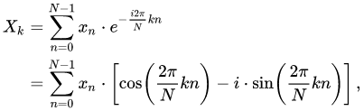
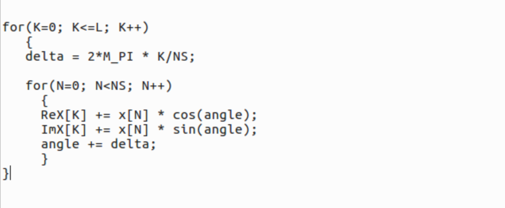
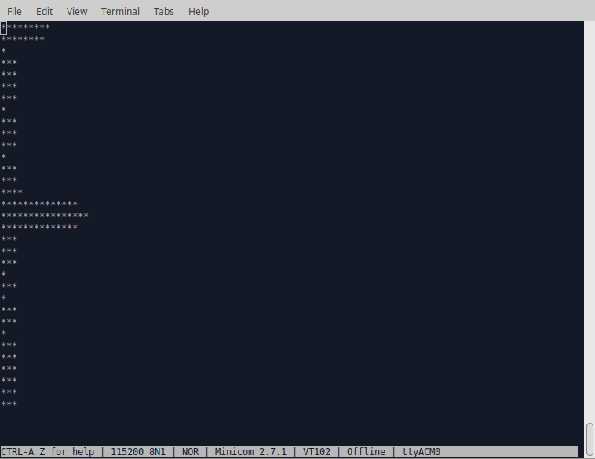

# FFTA - Fastest(?) Fourier Transform for Arduino

# Introduction
This project is about a fast C implementation of the Discrete Fourier Transform[1],[2] for Arduino. The provided DFT/FFT routines are computing the spectra from *real* input data, for example, data that comes from the (10-bit) ADC. The runtime measured for an 8-point DFT with ADC data is 844μs and for an 8-point FFT xxxμs.

With the 8-points data set example: *x=[0, 1, 0, 0, 0, 0, 0, 0]*, MATLAB's fft(x) returns:

*1.0000+0.0000i, 0.7071-0.7071i, 0.0000-1.0000i, -0.7071-0.7071i, -1.0000+0.0000i, -0.7071+0.7071i, 0.0000+1.0000i, 0.7071+0.7071i*

The output from example *dft5.ino* looks very similar:

*1.00  0.00i, 0.71  -0.71i, 0.00  -1.00i, -0.71  -0.71i, -1.00  0.00i, -0.71  0.71i, 0.00  1.00i, 0.71  0.71i*

In FFTA, the sin() and cos() calls are replaced by a sine look-up table (LUT) that is indexed by a Direct Digital Synthesis (DDS) phase accumulator[4], which is a fast implementation on a micro-controller. For the standard DFT this is mathematically equivalent to the common table-based twiddle-factor lookup, *table[(n·k mod N)·LUT_SIZE/N]*: the accumulator's unsigned overflow performs the modulo, and adding the phase increment replaces the multiplication n·k. Like that conventional approach, one fixed-length LUT serves every transform size up to the LUT length. For a power-of-two N that is not larger than the LUT, the phase increment RANGE/N is an exact integer, so the LUT indices are exact and there is no phase truncation error, whatever the accumulator width. In that case the accuracy is determined only by the LUT: its length and the amplitude resolution of its entries (10-bit in *dft2/dft3*, 8-bit in *dft4/dft5*). *dft2* (32-bit accumulator) and *dft3* (16-bit accumulator) therefore give identical results; the 16-bit accumulator is simply faster. The extra phase resolution of a 32-bit accumulator only matters when the phase increment is not exact, for example when N is not a power of two or is larger than the LUT, or when evaluating the spectrum at fractional bin frequencies. There is no internal overflow check on numbers. The recommended input data types for each example, are given in the table below under *Sketches*.

The DFT-core implemented in the C-language looks like:

# Sketches
Study Sketches | Remarks 
------ | -------
dft1.ino | DFT - floating point implementation using sin() and cos() functions. Input data type: *double* or *int* for real part only.
dft2.ino | DFT with 32bit DDS, 10bit Look-up table (LUT). Input data of type *int*, reals only.
dft3.ino | DFT with 16bit DDS, 10bit LUT. Input data of type *int*, reals only.
dft4.ino | DFT with 16bit DDS, 8bit LUT. Input data of type *char*, reals only. 
dft5.ino | DFT with 16bit DDS, 8bit LUT. ReX and ImX accumulators are reduced to *int*-types, with input data type *char*, reals only.
fft.ino | FFT with 16bit DDS, 10bit LUT. Input data type *double* with real+imaginary input.
ffta.ino | FFT with 16bit DDS, 10bit LUT. Input data of type *int*, reals only.
 **Applications** | 
spectrum.ino | Application example of DFT with 32 bit DDS, 10-bit LUT. Input data is from the ADC input A0. Apply AC voltage on 2.5V DC bias. Defaults: 64 points DFT, fs=8ksps with Hanning windowing and log scale. SPECTRUM PLOTTING DOES NOT WORK IN THE ARDUINO MONITOR. Use a VT100 compatible terminal emulator like minicom or PuTTY. 
spectrum2.ino | FFT

Example spectrum output with Udc = 2.5V + Uac = 1V, f_sinewave = 2kHz:

# Benchmarks
The measured runtime in μs of the different DFT variants running on the Arduino UNO are shown in the table below. The times noted in the table are for the full spectrum calculation (positive and negative frequencies). The data set used for bench-marking is: *x = 0, 1, 0, 0, ...*  [4].

Implementation / N-points: | 8 | 16 | 32 | 64
-------------------------- | - | -- | -- | --
dft1 | 16436 | 66056 | 265968 | 1074168
dft2 | 2228 | 7692 | 28368 | 108520
dft3 | 1424 | 4540 | 15848 | 58620 
dft4 | 844 | 2304 | 6922 | 23400
dft5 | 784 | 2096 | 6184 | 20236

# Conclusion
The computing time of the *dft1 to dft5* programs roughly scale with N^2 as was expected. The computing time of the well known FFT algorithm[1] scales with N*log2(N) and is much faster for larger values of N. The accuracy of the DFT variants is practically usable, even with the 8-bit LUT of *dft4/dft5*. For power-of-two N, the accuracy depends on the LUT, not on the width of the DDS accumulator.
Using a DDS wave generator in place of trigonometric functions is an idea that I wanted to test because of its compact and elegant implementation form. It is not a new DFT algorithm: the speed-up over *dft1* comes from integer arithmetic and table lookups, and the complexity stays O(N^2). Each frequency bin is in fact a numerically controlled oscillator (NCO) driving an I/Q multiply-accumulate, the same structure as a digital lock-in amplifier or digital down-converter. The DDS view becomes more useful outside the standard DFT grid, for example with non-power-of-two N, at fractional bin frequencies, or for tracking a single tunable frequency, where the phase resolution of a 32-bit accumulator does improve accuracy.

[1]: https://en.wikipedia.org/wiki/Fast_Fourier_transform

[2]: http://www.fftw.org/

[3]: http://www.sccon.ca/sccon/fft/fft3.htm

[4]: https://www.analog.com/en/resources/analog-dialogue/articles/all-about-direct-digital-synthesis.html

